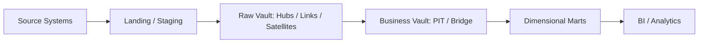
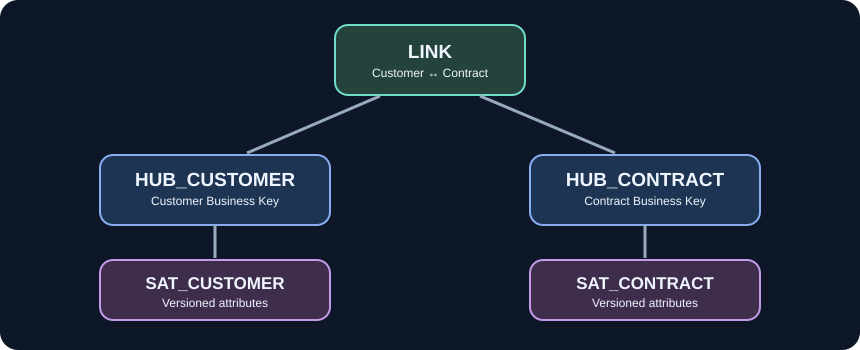
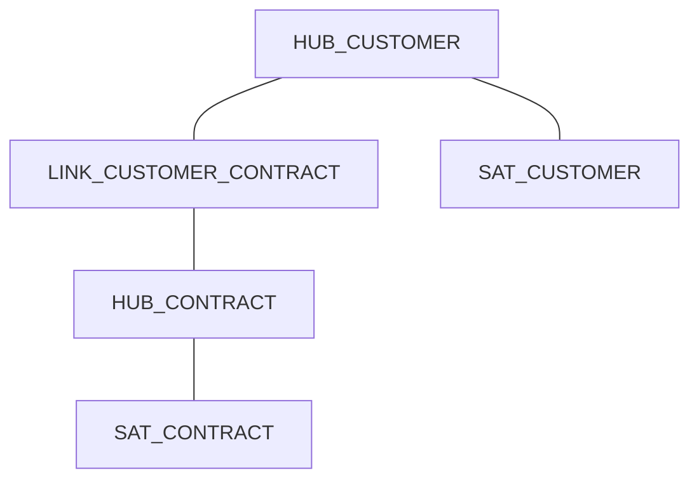

# 05. Core Data Vault Modeling — Hub, Link, Satellite

> Раздел образовательной программы Data Vault 2.0. Модуль 5 из 12.

## Назначение модуля

Hub фиксирует бизнес-идентичность, Link — отношения, Satellite — описания и их историю. Разделение помогает загружать источники независимо и восстанавливать происхождение изменений. Это центральный модуль программы.

## Банковский пример

HUB_CUSTOMER, HUB_CONTRACT, LINK_CUSTOMER_CONTRACT и SAT_CONTRACT_STATUS образуют каркас для истории договоров и их участников.

## Схема потока данных




## Схема структуры Hub–Link–Satellite





## Hub

### 1. Hub Purpose and Structure

**Определение и принцип.** Hub хранит уникальные бизнес-ключи сущности и технические метаданные происхождения. Обычно содержит hash key, business key, load timestamp и record source. Описательные меняющиеся атрибуты относятся к Satellites.

**Практическая интерпретация.** HUB_CUSTOMER(CUSTOMER_HK, CUSTOMER_BK, LOAD_DTS, RECORD_SOURCE).

**Ограничения и проверки.** Hub не обязан содержать «текущую» версию клиента: Hub фиксирует идентичность, а не состояние.

### 2. Business Key Selection

**Определение и принцип.** **Business Key Selection** — самостоятельное понятие в моделировании Raw Data Vault. При проектировании необходимо сформулировать его назначение, входные и выходные данные, правила применимости и зависимость от соседних компонентов. Для корректной реализации следует явно зафиксировать зерна объекта, технических ключей, load timestamp и record source. Термин рассматривается в контексте всей архитектуры, а не как изолированная настройка.

**Практическая интерпретация.** **Применение.** Рассмотрите этот механизм на примере HUB_CUSTOMER, LINK_CUSTOMER_CONTRACT и SAT_CONTRACT: определите уникальность записи, источник значений, момент изменения, способ повторной обработки и ожидаемый результат при расхождениях между источниками. Для данного понятия соответствующие решения должны быть описаны в контракте данных.

**Ограничения и проверки.** **Контроль и ограничения.** Проверяйте зерна объекта, технических ключей, load timestamp и record source. Для production необходимо предусмотреть тест корректности, диагностируемую ошибку и сохранение происхождения. Название компонента само по себе не гарантирует нужного поведения: правила зависят от реализации и платформы.

### 3. Single Business Key Hub

**Определение и принцип.** **Single Business Key Hub** — самостоятельное понятие в моделировании Raw Data Vault. При проектировании необходимо сформулировать его назначение, входные и выходные данные, правила применимости и зависимость от соседних компонентов. Для корректной реализации следует явно зафиксировать зерна объекта, технических ключей, load timestamp и record source. Термин рассматривается в контексте всей архитектуры, а не как изолированная настройка.

**Практическая интерпретация.** **Применение.** Рассмотрите этот механизм на примере HUB_CUSTOMER, LINK_CUSTOMER_CONTRACT и SAT_CONTRACT: определите уникальность записи, источник значений, момент изменения, способ повторной обработки и ожидаемый результат при расхождениях между источниками. Для данного понятия соответствующие решения должны быть описаны в контракте данных.

**Ограничения и проверки.** **Контроль и ограничения.** Проверяйте зерна объекта, технических ключей, load timestamp и record source. Для production необходимо предусмотреть тест корректности, диагностируемую ошибку и сохранение происхождения. Название компонента само по себе не гарантирует нужного поведения: правила зависят от реализации и платформы.

### 4. Composite Business Key Hub

**Определение и принцип.** **Composite Business Key Hub** — самостоятельное понятие в моделировании Raw Data Vault. При проектировании необходимо сформулировать его назначение, входные и выходные данные, правила применимости и зависимость от соседних компонентов. Для корректной реализации следует явно зафиксировать зерна объекта, технических ключей, load timestamp и record source. Термин рассматривается в контексте всей архитектуры, а не как изолированная настройка.

**Практическая интерпретация.** **Применение.** Рассмотрите этот механизм на примере HUB_CUSTOMER, LINK_CUSTOMER_CONTRACT и SAT_CONTRACT: определите уникальность записи, источник значений, момент изменения, способ повторной обработки и ожидаемый результат при расхождениях между источниками. Для данного понятия соответствующие решения должны быть описаны в контракте данных.

**Ограничения и проверки.** **Контроль и ограничения.** Проверяйте зерна объекта, технических ключей, load timestamp и record source. Для production необходимо предусмотреть тест корректности, диагностируемую ошибку и сохранение происхождения. Название компонента само по себе не гарантирует нужного поведения: правила зависят от реализации и платформы.

### 5. Hub Hash Key

**Определение и принцип.** **Hub Hash Key** — самостоятельное понятие в моделировании Raw Data Vault. При проектировании необходимо сформулировать его назначение, входные и выходные данные, правила применимости и зависимость от соседних компонентов. Для корректной реализации следует явно зафиксировать зерна объекта, технических ключей, load timestamp и record source. Термин рассматривается в контексте всей архитектуры, а не как изолированная настройка.

**Практическая интерпретация.** **Применение.** Рассмотрите этот механизм на примере HUB_CUSTOMER, LINK_CUSTOMER_CONTRACT и SAT_CONTRACT: определите уникальность записи, источник значений, момент изменения, способ повторной обработки и ожидаемый результат при расхождениях между источниками. Для данного понятия соответствующие решения должны быть описаны в контракте данных.

**Ограничения и проверки.** **Контроль и ограничения.** Проверяйте зерна объекта, технических ключей, load timestamp и record source. Для production необходимо предусмотреть тест корректности, диагностируемую ошибку и сохранение происхождения. Название компонента само по себе не гарантирует нужного поведения: правила зависят от реализации и платформы.

### 6. Hub Load Date

**Определение и принцип.** **Hub Load Date** — самостоятельное понятие в моделировании Raw Data Vault. При проектировании необходимо сформулировать его назначение, входные и выходные данные, правила применимости и зависимость от соседних компонентов. Для корректной реализации следует явно зафиксировать зерна объекта, технических ключей, load timestamp и record source. Термин рассматривается в контексте всей архитектуры, а не как изолированная настройка.

**Практическая интерпретация.** **Применение.** Рассмотрите этот механизм на примере HUB_CUSTOMER, LINK_CUSTOMER_CONTRACT и SAT_CONTRACT: определите уникальность записи, источник значений, момент изменения, способ повторной обработки и ожидаемый результат при расхождениях между источниками. Для данного понятия соответствующие решения должны быть описаны в контракте данных.

**Ограничения и проверки.** **Контроль и ограничения.** Проверяйте зерна объекта, технических ключей, load timestamp и record source. Для production необходимо предусмотреть тест корректности, диагностируемую ошибку и сохранение происхождения. Название компонента само по себе не гарантирует нужного поведения: правила зависят от реализации и платформы.

### 7. Record Source

**Определение и принцип.** **Record Source** — самостоятельное понятие в моделировании Raw Data Vault. При проектировании необходимо сформулировать его назначение, входные и выходные данные, правила применимости и зависимость от соседних компонентов. Для корректной реализации следует явно зафиксировать зерна объекта, технических ключей, load timestamp и record source. Термин рассматривается в контексте всей архитектуры, а не как изолированная настройка.

**Практическая интерпретация.** **Применение.** Рассмотрите этот механизм на примере HUB_CUSTOMER, LINK_CUSTOMER_CONTRACT и SAT_CONTRACT: определите уникальность записи, источник значений, момент изменения, способ повторной обработки и ожидаемый результат при расхождениях между источниками. Для данного понятия соответствующие решения должны быть описаны в контракте данных.

**Ограничения и проверки.** **Контроль и ограничения.** Проверяйте зерна объекта, технических ключей, load timestamp и record source. Для production необходимо предусмотреть тест корректности, диагностируемую ошибку и сохранение происхождения. Название компонента само по себе не гарантирует нужного поведения: правила зависят от реализации и платформы.

### 8. Hub Uniqueness

**Определение и принцип.** **Hub Uniqueness** — самостоятельное понятие в моделировании Raw Data Vault. При проектировании необходимо сформулировать его назначение, входные и выходные данные, правила применимости и зависимость от соседних компонентов. Для корректной реализации следует явно зафиксировать зерна объекта, технических ключей, load timestamp и record source. Термин рассматривается в контексте всей архитектуры, а не как изолированная настройка.

**Практическая интерпретация.** **Применение.** Рассмотрите этот механизм на примере HUB_CUSTOMER, LINK_CUSTOMER_CONTRACT и SAT_CONTRACT: определите уникальность записи, источник значений, момент изменения, способ повторной обработки и ожидаемый результат при расхождениях между источниками. Для данного понятия соответствующие решения должны быть описаны в контракте данных.

**Ограничения и проверки.** **Контроль и ограничения.** Проверяйте зерна объекта, технических ключей, load timestamp и record source. Для production необходимо предусмотреть тест корректности, диагностируемую ошибку и сохранение происхождения. Название компонента само по себе не гарантирует нужного поведения: правила зависят от реализации и платформы.

### 9. Multi-Source Hub Loading

**Определение и принцип.** **Multi-Source Hub Loading** — самостоятельное понятие в моделировании Raw Data Vault. При проектировании необходимо сформулировать его назначение, входные и выходные данные, правила применимости и зависимость от соседних компонентов. Для корректной реализации следует явно зафиксировать зерна объекта, технических ключей, load timestamp и record source. Термин рассматривается в контексте всей архитектуры, а не как изолированная настройка.

**Практическая интерпретация.** **Применение.** Рассмотрите этот механизм на примере HUB_CUSTOMER, LINK_CUSTOMER_CONTRACT и SAT_CONTRACT: определите уникальность записи, источник значений, момент изменения, способ повторной обработки и ожидаемый результат при расхождениях между источниками. Для данного понятия соответствующие решения должны быть описаны в контракте данных.

**Ограничения и проверки.** **Контроль и ограничения.** Проверяйте зерна объекта, технических ключей, load timestamp и record source. Для production необходимо предусмотреть тест корректности, диагностируемую ошибку и сохранение происхождения. Название компонента само по себе не гарантирует нужного поведения: правила зависят от реализации и платформы.

### 10. Hub Naming Conventions

**Определение и принцип.** **Hub Naming Conventions** — самостоятельное понятие в моделировании Raw Data Vault. При проектировании необходимо сформулировать его назначение, входные и выходные данные, правила применимости и зависимость от соседних компонентов. Для корректной реализации следует явно зафиксировать зерна объекта, технических ключей, load timestamp и record source. Термин рассматривается в контексте всей архитектуры, а не как изолированная настройка.

**Практическая интерпретация.** **Применение.** Рассмотрите этот механизм на примере HUB_CUSTOMER, LINK_CUSTOMER_CONTRACT и SAT_CONTRACT: определите уникальность записи, источник значений, момент изменения, способ повторной обработки и ожидаемый результат при расхождениях между источниками. Для данного понятия соответствующие решения должны быть описаны в контракте данных.

**Ограничения и проверки.** **Контроль и ограничения.** Проверяйте зерна объекта, технических ключей, load timestamp и record source. Для production необходимо предусмотреть тест корректности, диагностируемую ошибку и сохранение происхождения. Название компонента само по себе не гарантирует нужного поведения: правила зависят от реализации и платформы.

## Link

### 11. Link Purpose and Structure

**Определение и принцип.** Link фиксирует существование отношения между Hub-ключами или экземплярами бизнес-событий. Он хранит идентификаторы участников, ключ Link и происхождение. Историческое описание отношения выносится в Satellite.

**Практическая интерпретация.** LINK_CUSTOMER_ACCOUNT(LINK_HK, CUSTOMER_HK, ACCOUNT_HK, LOAD_DTS, RECORD_SOURCE).

**Ограничения и проверки.** Заранее определите grain Link: участие клиента в счёте и событие назначения роли — разные отношения.

### 12. Relationship Grain

**Определение и принцип.** **Relationship Grain** — самостоятельное понятие в моделировании Raw Data Vault. При проектировании необходимо сформулировать его назначение, входные и выходные данные, правила применимости и зависимость от соседних компонентов. Для корректной реализации следует явно зафиксировать зерна объекта, технических ключей, load timestamp и record source. Термин рассматривается в контексте всей архитектуры, а не как изолированная настройка.

**Практическая интерпретация.** **Применение.** Рассмотрите этот механизм на примере HUB_CUSTOMER, LINK_CUSTOMER_CONTRACT и SAT_CONTRACT: определите уникальность записи, источник значений, момент изменения, способ повторной обработки и ожидаемый результат при расхождениях между источниками. Для данного понятия соответствующие решения должны быть описаны в контракте данных.

**Ограничения и проверки.** **Контроль и ограничения.** Проверяйте зерна объекта, технических ключей, load timestamp и record source. Для production необходимо предусмотреть тест корректности, диагностируемую ошибку и сохранение происхождения. Название компонента само по себе не гарантирует нужного поведения: правила зависят от реализации и платформы.

### 13. Link Hash Keys

**Определение и принцип.** **Link Hash Keys** — самостоятельное понятие в моделировании Raw Data Vault. При проектировании необходимо сформулировать его назначение, входные и выходные данные, правила применимости и зависимость от соседних компонентов. Для корректной реализации следует явно зафиксировать зерна объекта, технических ключей, load timestamp и record source. Термин рассматривается в контексте всей архитектуры, а не как изолированная настройка.

**Практическая интерпретация.** **Применение.** Рассмотрите этот механизм на примере HUB_CUSTOMER, LINK_CUSTOMER_CONTRACT и SAT_CONTRACT: определите уникальность записи, источник значений, момент изменения, способ повторной обработки и ожидаемый результат при расхождениях между источниками. Для данного понятия соответствующие решения должны быть описаны в контракте данных.

**Ограничения и проверки.** **Контроль и ограничения.** Проверяйте зерна объекта, технических ключей, load timestamp и record source. Для production необходимо предусмотреть тест корректности, диагностируемую ошибку и сохранение происхождения. Название компонента само по себе не гарантирует нужного поведения: правила зависят от реализации и платформы.

### 14. Link Foreign Hash Keys

**Определение и принцип.** **Link Foreign Hash Keys** — самостоятельное понятие в моделировании Raw Data Vault. При проектировании необходимо сформулировать его назначение, входные и выходные данные, правила применимости и зависимость от соседних компонентов. Для корректной реализации следует явно зафиксировать зерна объекта, технических ключей, load timestamp и record source. Термин рассматривается в контексте всей архитектуры, а не как изолированная настройка.

**Практическая интерпретация.** **Применение.** Рассмотрите этот механизм на примере HUB_CUSTOMER, LINK_CUSTOMER_CONTRACT и SAT_CONTRACT: определите уникальность записи, источник значений, момент изменения, способ повторной обработки и ожидаемый результат при расхождениях между источниками. Для данного понятия соответствующие решения должны быть описаны в контракте данных.

**Ограничения и проверки.** **Контроль и ограничения.** Проверяйте зерна объекта, технических ключей, load timestamp и record source. Для production необходимо предусмотреть тест корректности, диагностируемую ошибку и сохранение происхождения. Название компонента само по себе не гарантирует нужного поведения: правила зависят от реализации и платформы.

### 15. Two-Hub Links

**Определение и принцип.** **Two-Hub Links** — самостоятельное понятие в моделировании Raw Data Vault. При проектировании необходимо сформулировать его назначение, входные и выходные данные, правила применимости и зависимость от соседних компонентов. Для корректной реализации следует явно зафиксировать зерна объекта, технических ключей, load timestamp и record source. Термин рассматривается в контексте всей архитектуры, а не как изолированная настройка.

**Практическая интерпретация.** **Применение.** Рассмотрите этот механизм на примере HUB_CUSTOMER, LINK_CUSTOMER_CONTRACT и SAT_CONTRACT: определите уникальность записи, источник значений, момент изменения, способ повторной обработки и ожидаемый результат при расхождениях между источниками. Для данного понятия соответствующие решения должны быть описаны в контракте данных.

**Ограничения и проверки.** **Контроль и ограничения.** Проверяйте зерна объекта, технических ключей, load timestamp и record source. Для production необходимо предусмотреть тест корректности, диагностируемую ошибку и сохранение происхождения. Название компонента само по себе не гарантирует нужного поведения: правила зависят от реализации и платформы.

### 16. Multi-Hub Links

**Определение и принцип.** **Multi-Hub Links** — самостоятельное понятие в моделировании Raw Data Vault. При проектировании необходимо сформулировать его назначение, входные и выходные данные, правила применимости и зависимость от соседних компонентов. Для корректной реализации следует явно зафиксировать зерна объекта, технических ключей, load timestamp и record source. Термин рассматривается в контексте всей архитектуры, а не как изолированная настройка.

**Практическая интерпретация.** **Применение.** Рассмотрите этот механизм на примере HUB_CUSTOMER, LINK_CUSTOMER_CONTRACT и SAT_CONTRACT: определите уникальность записи, источник значений, момент изменения, способ повторной обработки и ожидаемый результат при расхождениях между источниками. Для данного понятия соответствующие решения должны быть описаны в контракте данных.

**Ограничения и проверки.** **Контроль и ограничения.** Проверяйте зерна объекта, технических ключей, load timestamp и record source. Для production необходимо предусмотреть тест корректности, диагностируемую ошибку и сохранение происхождения. Название компонента само по себе не гарантирует нужного поведения: правила зависят от реализации и платформы.

### 17. Recursive Links

**Определение и принцип.** **Recursive Links** — самостоятельное понятие в моделировании Raw Data Vault. При проектировании необходимо сформулировать его назначение, входные и выходные данные, правила применимости и зависимость от соседних компонентов. Для корректной реализации следует явно зафиксировать зерна объекта, технических ключей, load timestamp и record source. Термин рассматривается в контексте всей архитектуры, а не как изолированная настройка.

**Практическая интерпретация.** **Применение.** Рассмотрите этот механизм на примере HUB_CUSTOMER, LINK_CUSTOMER_CONTRACT и SAT_CONTRACT: определите уникальность записи, источник значений, момент изменения, способ повторной обработки и ожидаемый результат при расхождениях между источниками. Для данного понятия соответствующие решения должны быть описаны в контракте данных.

**Ограничения и проверки.** **Контроль и ограничения.** Проверяйте зерна объекта, технических ключей, load timestamp и record source. Для production необходимо предусмотреть тест корректности, диагностируемую ошибку и сохранение происхождения. Название компонента само по себе не гарантирует нужного поведения: правила зависят от реализации и платформы.

### 18. Relationship Cardinality

**Определение и принцип.** **Relationship Cardinality** — самостоятельное понятие в моделировании Raw Data Vault. При проектировании необходимо сформулировать его назначение, входные и выходные данные, правила применимости и зависимость от соседних компонентов. Для корректной реализации следует явно зафиксировать зерна объекта, технических ключей, load timestamp и record source. Термин рассматривается в контексте всей архитектуры, а не как изолированная настройка.

**Практическая интерпретация.** **Применение.** Рассмотрите этот механизм на примере HUB_CUSTOMER, LINK_CUSTOMER_CONTRACT и SAT_CONTRACT: определите уникальность записи, источник значений, момент изменения, способ повторной обработки и ожидаемый результат при расхождениях между источниками. Для данного понятия соответствующие решения должны быть описаны в контракте данных.

**Ограничения и проверки.** **Контроль и ограничения.** Проверяйте зерна объекта, технических ключей, load timestamp и record source. Для production необходимо предусмотреть тест корректности, диагностируемую ошибку и сохранение происхождения. Название компонента само по себе не гарантирует нужного поведения: правила зависят от реализации и платформы.

### 19. Link Uniqueness

**Определение и принцип.** **Link Uniqueness** — самостоятельное понятие в моделировании Raw Data Vault. При проектировании необходимо сформулировать его назначение, входные и выходные данные, правила применимости и зависимость от соседних компонентов. Для корректной реализации следует явно зафиксировать зерна объекта, технических ключей, load timestamp и record source. Термин рассматривается в контексте всей архитектуры, а не как изолированная настройка.

**Практическая интерпретация.** **Применение.** Рассмотрите этот механизм на примере HUB_CUSTOMER, LINK_CUSTOMER_CONTRACT и SAT_CONTRACT: определите уникальность записи, источник значений, момент изменения, способ повторной обработки и ожидаемый результат при расхождениях между источниками. Для данного понятия соответствующие решения должны быть описаны в контракте данных.

**Ограничения и проверки.** **Контроль и ограничения.** Проверяйте зерна объекта, технических ключей, load timestamp и record source. Для production необходимо предусмотреть тест корректности, диагностируемую ошибку и сохранение происхождения. Название компонента само по себе не гарантирует нужного поведения: правила зависят от реализации и платформы.

### 20. Transactional Relationships

**Определение и принцип.** **Transactional Relationships** — самостоятельное понятие в моделировании Raw Data Vault. При проектировании необходимо сформулировать его назначение, входные и выходные данные, правила применимости и зависимость от соседних компонентов. Для корректной реализации следует явно зафиксировать зерна объекта, технических ключей, load timestamp и record source. Термин рассматривается в контексте всей архитектуры, а не как изолированная настройка.

**Практическая интерпретация.** **Применение.** Рассмотрите этот механизм на примере HUB_CUSTOMER, LINK_CUSTOMER_CONTRACT и SAT_CONTRACT: определите уникальность записи, источник значений, момент изменения, способ повторной обработки и ожидаемый результат при расхождениях между источниками. Для данного понятия соответствующие решения должны быть описаны в контракте данных.

**Ограничения и проверки.** **Контроль и ограничения.** Проверяйте зерна объекта, технических ключей, load timestamp и record source. Для production необходимо предусмотреть тест корректности, диагностируемую ошибку и сохранение происхождения. Название компонента само по себе не гарантирует нужного поведения: правила зависят от реализации и платформы.

### 21. Link Loading from Multiple Sources

**Определение и принцип.** **Link Loading from Multiple Sources** — самостоятельное понятие в моделировании Raw Data Vault. При проектировании необходимо сформулировать его назначение, входные и выходные данные, правила применимости и зависимость от соседних компонентов. Для корректной реализации следует явно зафиксировать зерна объекта, технических ключей, load timestamp и record source. Термин рассматривается в контексте всей архитектуры, а не как изолированная настройка.

**Практическая интерпретация.** **Применение.** Рассмотрите этот механизм на примере HUB_CUSTOMER, LINK_CUSTOMER_CONTRACT и SAT_CONTRACT: определите уникальность записи, источник значений, момент изменения, способ повторной обработки и ожидаемый результат при расхождениях между источниками. Для данного понятия соответствующие решения должны быть описаны в контракте данных.

**Ограничения и проверки.** **Контроль и ограничения.** Проверяйте зерна объекта, технических ключей, load timestamp и record source. Для production необходимо предусмотреть тест корректности, диагностируемую ошибку и сохранение происхождения. Название компонента само по себе не гарантирует нужного поведения: правила зависят от реализации и платформы.

## Satellite

### 22. Satellite Purpose and Structure

**Определение и принцип.** Satellite хранит исторические описательные атрибуты Hub или Link. Новые версии обычно добавляются при изменении payload, определяемом hashdiff либо сравнением атрибутов.

**Практическая интерпретация.** SAT_CUSTOMER_DETAILS(CUSTOMER_HK, LOAD_DTS, NAME, STATUS, HASHDIFF, RECORD_SOURCE).

**Ограничения и проверки.** Для воспроизводимости важно определить смысл LOAD_DTS, источник времён и правила late-arriving данных.

### 23. Satellite Payload

**Определение и принцип.** **Satellite Payload** — самостоятельное понятие в моделировании Raw Data Vault. При проектировании необходимо сформулировать его назначение, входные и выходные данные, правила применимости и зависимость от соседних компонентов. Для корректной реализации следует явно зафиксировать зерна объекта, технических ключей, load timestamp и record source. Термин рассматривается в контексте всей архитектуры, а не как изолированная настройка.

**Практическая интерпретация.** **Применение.** Рассмотрите этот механизм на примере HUB_CUSTOMER, LINK_CUSTOMER_CONTRACT и SAT_CONTRACT: определите уникальность записи, источник значений, момент изменения, способ повторной обработки и ожидаемый результат при расхождениях между источниками. Для данного понятия соответствующие решения должны быть описаны в контракте данных.

**Ограничения и проверки.** **Контроль и ограничения.** Проверяйте зерна объекта, технических ключей, load timestamp и record source. Для production необходимо предусмотреть тест корректности, диагностируемую ошибку и сохранение происхождения. Название компонента само по себе не гарантирует нужного поведения: правила зависят от реализации и платформы.

### 24. Hashdiff

**Определение и принцип.** **Hashdiff** — самостоятельное понятие в моделировании Raw Data Vault. При проектировании необходимо сформулировать его назначение, входные и выходные данные, правила применимости и зависимость от соседних компонентов. Для корректной реализации следует явно зафиксировать зерна объекта, технических ключей, load timestamp и record source. Термин рассматривается в контексте всей архитектуры, а не как изолированная настройка.

**Практическая интерпретация.** **Применение.** Рассмотрите этот механизм на примере HUB_CUSTOMER, LINK_CUSTOMER_CONTRACT и SAT_CONTRACT: определите уникальность записи, источник значений, момент изменения, способ повторной обработки и ожидаемый результат при расхождениях между источниками. Для данного понятия соответствующие решения должны быть описаны в контракте данных.

**Ограничения и проверки.** **Контроль и ограничения.** Проверяйте зерна объекта, технических ключей, load timestamp и record source. Для production необходимо предусмотреть тест корректности, диагностируемую ошибку и сохранение происхождения. Название компонента само по себе не гарантирует нужного поведения: правила зависят от реализации и платформы.

### 25. Hub Satellites

**Определение и принцип.** **Hub Satellites** — самостоятельное понятие в моделировании Raw Data Vault. При проектировании необходимо сформулировать его назначение, входные и выходные данные, правила применимости и зависимость от соседних компонентов. Для корректной реализации следует явно зафиксировать зерна объекта, технических ключей, load timestamp и record source. Термин рассматривается в контексте всей архитектуры, а не как изолированная настройка.

**Практическая интерпретация.** **Применение.** Рассмотрите этот механизм на примере HUB_CUSTOMER, LINK_CUSTOMER_CONTRACT и SAT_CONTRACT: определите уникальность записи, источник значений, момент изменения, способ повторной обработки и ожидаемый результат при расхождениях между источниками. Для данного понятия соответствующие решения должны быть описаны в контракте данных.

**Ограничения и проверки.** **Контроль и ограничения.** Проверяйте зерна объекта, технических ключей, load timestamp и record source. Для production необходимо предусмотреть тест корректности, диагностируемую ошибку и сохранение происхождения. Название компонента само по себе не гарантирует нужного поведения: правила зависят от реализации и платформы.

### 26. Link Satellites

**Определение и принцип.** **Link Satellites** — самостоятельное понятие в моделировании Raw Data Vault. При проектировании необходимо сформулировать его назначение, входные и выходные данные, правила применимости и зависимость от соседних компонентов. Для корректной реализации следует явно зафиксировать зерна объекта, технических ключей, load timestamp и record source. Термин рассматривается в контексте всей архитектуры, а не как изолированная настройка.

**Практическая интерпретация.** **Применение.** Рассмотрите этот механизм на примере HUB_CUSTOMER, LINK_CUSTOMER_CONTRACT и SAT_CONTRACT: определите уникальность записи, источник значений, момент изменения, способ повторной обработки и ожидаемый результат при расхождениях между источниками. Для данного понятия соответствующие решения должны быть описаны в контракте данных.

**Ограничения и проверки.** **Контроль и ограничения.** Проверяйте зерна объекта, технических ключей, load timestamp и record source. Для production необходимо предусмотреть тест корректности, диагностируемую ошибку и сохранение происхождения. Название компонента само по себе не гарантирует нужного поведения: правила зависят от реализации и платформы.

### 27. Satellite Load Date

**Определение и принцип.** **Satellite Load Date** — самостоятельное понятие в моделировании Raw Data Vault. При проектировании необходимо сформулировать его назначение, входные и выходные данные, правила применимости и зависимость от соседних компонентов. Для корректной реализации следует явно зафиксировать зерна объекта, технических ключей, load timestamp и record source. Термин рассматривается в контексте всей архитектуры, а не как изолированная настройка.

**Практическая интерпретация.** **Применение.** Рассмотрите этот механизм на примере HUB_CUSTOMER, LINK_CUSTOMER_CONTRACT и SAT_CONTRACT: определите уникальность записи, источник значений, момент изменения, способ повторной обработки и ожидаемый результат при расхождениях между источниками. Для данного понятия соответствующие решения должны быть описаны в контракте данных.

**Ограничения и проверки.** **Контроль и ограничения.** Проверяйте зерна объекта, технических ключей, load timestamp и record source. Для production необходимо предусмотреть тест корректности, диагностируемую ошибку и сохранение происхождения. Название компонента само по себе не гарантирует нужного поведения: правила зависят от реализации и платформы.

### 28. Satellite Primary Key

**Определение и принцип.** **Satellite Primary Key** — самостоятельное понятие в моделировании Raw Data Vault. При проектировании необходимо сформулировать его назначение, входные и выходные данные, правила применимости и зависимость от соседних компонентов. Для корректной реализации следует явно зафиксировать зерна объекта, технических ключей, load timestamp и record source. Термин рассматривается в контексте всей архитектуры, а не как изолированная настройка.

**Практическая интерпретация.** **Применение.** Рассмотрите этот механизм на примере HUB_CUSTOMER, LINK_CUSTOMER_CONTRACT и SAT_CONTRACT: определите уникальность записи, источник значений, момент изменения, способ повторной обработки и ожидаемый результат при расхождениях между источниками. Для данного понятия соответствующие решения должны быть описаны в контракте данных.

**Ограничения и проверки.** **Контроль и ограничения.** Проверяйте зерна объекта, технических ключей, load timestamp и record source. Для production необходимо предусмотреть тест корректности, диагностируемую ошибку и сохранение происхождения. Название компонента само по себе не гарантирует нужного поведения: правила зависят от реализации и платформы.

### 29. Change Detection

**Определение и принцип.** **Change Detection** — самостоятельное понятие в моделировании Raw Data Vault. При проектировании необходимо сформулировать его назначение, входные и выходные данные, правила применимости и зависимость от соседних компонентов. Для корректной реализации следует явно зафиксировать зерна объекта, технических ключей, load timestamp и record source. Термин рассматривается в контексте всей архитектуры, а не как изолированная настройка.

**Практическая интерпретация.** **Применение.** Рассмотрите этот механизм на примере HUB_CUSTOMER, LINK_CUSTOMER_CONTRACT и SAT_CONTRACT: определите уникальность записи, источник значений, момент изменения, способ повторной обработки и ожидаемый результат при расхождениях между источниками. Для данного понятия соответствующие решения должны быть описаны в контракте данных.

**Ограничения и проверки.** **Контроль и ограничения.** Проверяйте зерна объекта, технических ключей, load timestamp и record source. Для production необходимо предусмотреть тест корректности, диагностируемую ошибку и сохранение происхождения. Название компонента само по себе не гарантирует нужного поведения: правила зависят от реализации и платформы.

### 30. Insert-only History

**Определение и принцип.** **Insert-only History** — самостоятельное понятие в моделировании Raw Data Vault. При проектировании необходимо сформулировать его назначение, входные и выходные данные, правила применимости и зависимость от соседних компонентов. Для корректной реализации следует явно зафиксировать зерна объекта, технических ключей, load timestamp и record source. Термин рассматривается в контексте всей архитектуры, а не как изолированная настройка.

**Практическая интерпретация.** **Применение.** Рассмотрите этот механизм на примере HUB_CUSTOMER, LINK_CUSTOMER_CONTRACT и SAT_CONTRACT: определите уникальность записи, источник значений, момент изменения, способ повторной обработки и ожидаемый результат при расхождениях между источниками. Для данного понятия соответствующие решения должны быть описаны в контракте данных.

**Ограничения и проверки.** **Контроль и ограничения.** Проверяйте зерна объекта, технических ключей, load timestamp и record source. Для production необходимо предусмотреть тест корректности, диагностируемую ошибку и сохранение происхождения. Название компонента само по себе не гарантирует нужного поведения: правила зависят от реализации и платформы.

### 31. Historical Versions

**Определение и принцип.** **Historical Versions** — самостоятельное понятие в моделировании Raw Data Vault. При проектировании необходимо сформулировать его назначение, входные и выходные данные, правила применимости и зависимость от соседних компонентов. Для корректной реализации следует явно зафиксировать зерна объекта, технических ключей, load timestamp и record source. Термин рассматривается в контексте всей архитектуры, а не как изолированная настройка.

**Практическая интерпретация.** **Применение.** Рассмотрите этот механизм на примере HUB_CUSTOMER, LINK_CUSTOMER_CONTRACT и SAT_CONTRACT: определите уникальность записи, источник значений, момент изменения, способ повторной обработки и ожидаемый результат при расхождениях между источниками. Для данного понятия соответствующие решения должны быть описаны в контракте данных.

**Ограничения и проверки.** **Контроль и ограничения.** Проверяйте зерна объекта, технических ключей, load timestamp и record source. Для production необходимо предусмотреть тест корректности, диагностируемую ошибку и сохранение происхождения. Название компонента само по себе не гарантирует нужного поведения: правила зависят от реализации и платформы.

### 32. Attribute Grouping

**Определение и принцип.** **Attribute Grouping** — самостоятельное понятие в моделировании Raw Data Vault. При проектировании необходимо сформулировать его назначение, входные и выходные данные, правила применимости и зависимость от соседних компонентов. Для корректной реализации следует явно зафиксировать зерна объекта, технических ключей, load timestamp и record source. Термин рассматривается в контексте всей архитектуры, а не как изолированная настройка.

**Практическая интерпретация.** **Применение.** Рассмотрите этот механизм на примере HUB_CUSTOMER, LINK_CUSTOMER_CONTRACT и SAT_CONTRACT: определите уникальность записи, источник значений, момент изменения, способ повторной обработки и ожидаемый результат при расхождениях между источниками. Для данного понятия соответствующие решения должны быть описаны в контракте данных.

**Ограничения и проверки.** **Контроль и ограничения.** Проверяйте зерна объекта, технических ключей, load timestamp и record source. Для production необходимо предусмотреть тест корректности, диагностируемую ошибку и сохранение происхождения. Название компонента само по себе не гарантирует нужного поведения: правила зависят от реализации и платформы.

### 33. Satellite Splitting

**Определение и принцип.** **Satellite Splitting** — самостоятельное понятие в моделировании Raw Data Vault. При проектировании необходимо сформулировать его назначение, входные и выходные данные, правила применимости и зависимость от соседних компонентов. Для корректной реализации следует явно зафиксировать зерна объекта, технических ключей, load timestamp и record source. Термин рассматривается в контексте всей архитектуры, а не как изолированная настройка.

**Практическая интерпретация.** **Применение.** Рассмотрите этот механизм на примере HUB_CUSTOMER, LINK_CUSTOMER_CONTRACT и SAT_CONTRACT: определите уникальность записи, источник значений, момент изменения, способ повторной обработки и ожидаемый результат при расхождениях между источниками. Для данного понятия соответствующие решения должны быть описаны в контракте данных.

**Ограничения и проверки.** **Контроль и ограничения.** Проверяйте зерна объекта, технических ключей, load timestamp и record source. Для production необходимо предусмотреть тест корректности, диагностируемую ошибку и сохранение происхождения. Название компонента само по себе не гарантирует нужного поведения: правила зависят от реализации и платформы.

### 34. Source-Driven Satellites

**Определение и принцип.** **Source-Driven Satellites** — самостоятельное понятие в моделировании Raw Data Vault. При проектировании необходимо сформулировать его назначение, входные и выходные данные, правила применимости и зависимость от соседних компонентов. Для корректной реализации следует явно зафиксировать зерна объекта, технических ключей, load timestamp и record source. Термин рассматривается в контексте всей архитектуры, а не как изолированная настройка.

**Практическая интерпретация.** **Применение.** Рассмотрите этот механизм на примере HUB_CUSTOMER, LINK_CUSTOMER_CONTRACT и SAT_CONTRACT: определите уникальность записи, источник значений, момент изменения, способ повторной обработки и ожидаемый результат при расхождениях между источниками. Для данного понятия соответствующие решения должны быть описаны в контракте данных.

**Ограничения и проверки.** **Контроль и ограничения.** Проверяйте зерна объекта, технических ключей, load timestamp и record source. Для production необходимо предусмотреть тест корректности, диагностируемую ошибку и сохранение происхождения. Название компонента само по себе не гарантирует нужного поведения: правила зависят от реализации и платформы.

### 35. Rate of Change

**Определение и принцип.** **Rate of Change** — самостоятельное понятие в моделировании Raw Data Vault. При проектировании необходимо сформулировать его назначение, входные и выходные данные, правила применимости и зависимость от соседних компонентов. Для корректной реализации следует явно зафиксировать зерна объекта, технических ключей, load timestamp и record source. Термин рассматривается в контексте всей архитектуры, а не как изолированная настройка.

**Практическая интерпретация.** **Применение.** Рассмотрите этот механизм на примере HUB_CUSTOMER, LINK_CUSTOMER_CONTRACT и SAT_CONTRACT: определите уникальность записи, источник значений, момент изменения, способ повторной обработки и ожидаемый результат при расхождениях между источниками. Для данного понятия соответствующие решения должны быть описаны в контракте данных.

**Ограничения и проверки.** **Контроль и ограничения.** Проверяйте зерна объекта, технических ключей, load timestamp и record source. Для production необходимо предусмотреть тест корректности, диагностируемую ошибку и сохранение происхождения. Название компонента само по себе не гарантирует нужного поведения: правила зависят от реализации и платформы.

### 36. Satellite Naming Conventions

**Определение и принцип.** **Satellite Naming Conventions** — самостоятельное понятие в моделировании Raw Data Vault. При проектировании необходимо сформулировать его назначение, входные и выходные данные, правила применимости и зависимость от соседних компонентов. Для корректной реализации следует явно зафиксировать зерна объекта, технических ключей, load timestamp и record source. Термин рассматривается в контексте всей архитектуры, а не как изолированная настройка.

**Практическая интерпретация.** **Применение.** Рассмотрите этот механизм на примере HUB_CUSTOMER, LINK_CUSTOMER_CONTRACT и SAT_CONTRACT: определите уникальность записи, источник значений, момент изменения, способ повторной обработки и ожидаемый результат при расхождениях между источниками. Для данного понятия соответствующие решения должны быть описаны в контракте данных.

**Ограничения и проверки.** **Контроль и ограничения.** Проверяйте зерна объекта, технических ключей, load timestamp и record source. Для production необходимо предусмотреть тест корректности, диагностируемую ошибку и сохранение происхождения. Название компонента само по себе не гарантирует нужного поведения: правила зависят от реализации и платформы.

## Технический пример

```sql
CREATE TABLE hub_customer (
  customer_hk text PRIMARY KEY,
  customer_bk text NOT NULL,
  load_dts timestamptz NOT NULL,
  record_source text NOT NULL
);
CREATE TABLE sat_customer_status (
  customer_hk text NOT NULL,
  load_dts timestamptz NOT NULL,
  status text,
  hashdiff text NOT NULL,
  record_source text NOT NULL,
  PRIMARY KEY(customer_hk, load_dts)
);
-- Упрощённая учебная схема; реальные ключи загрузки зависят от паттерна.
```

## Контрольные вопросы для понимания

1. Какова точная бизнес-сущность или операция, которую описывает рассматриваемая конструкция?
2. Что является уникальным ключом и зерном данных?
3. Какие временные поля отражают событие, действительность и загрузку?
4. Как повторная загрузка и поздние события влияют на результат?
5. Как воспроизвести показатель и установить его происхождение?
6. Какие ограничения реализации должны быть зафиксированы в контракте?

## Первичные источники и документация

- [automate-dv.readthedocs.io — документация](https://automate-dv.readthedocs.io/en/latest/tutorial/tut_hubs/)
- [automate-dv.readthedocs.io — документация](https://automate-dv.readthedocs.io/en/latest/tutorial/tut_links/)
- [automate-dv.readthedocs.io — документация](https://automate-dv.readthedocs.io/en/latest/tutorial/tut_satellites/)
- [www.datavault4dbt.com — документация](https://www.datavault4dbt.com/documentation/macro-instructions/)

## Примечание о применимости

Текст представляет учебное систематизированное объяснение. Конкретные решения по ключам, временной семантике, загрузке и производительности должны проверяться по документации используемой версии продукта и внутренним требованиям архитектуры.
