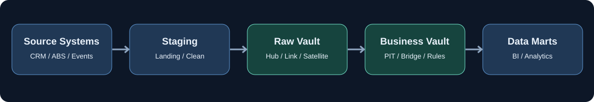

# 09. Business Vault, PIT & Bridge

> Раздел образовательной программы Data Vault 2.0. Модуль 9 из 12.

## Назначение модуля

Business Vault предоставляет бизнес-интерпретации поверх Raw Vault. PIT и Bridge сокращают сложность повторяемых аналитических запросов, но требуют строгой временной семантики и механизма пересчёта.

## Банковский пример

PIT на конец месяца выбирает версии сателлитов для расчёта статуса договора. Business Vault применяет правила дефолта и формирует итог для витрины.

## Схема потока данных

### 1. Raw Vault vs Business Vault

**Определение и принцип.** **Raw Vault vs Business Vault** — самостоятельное понятие в Business Vault. При проектировании необходимо сформулировать его назначение, входные и выходные данные, правила применимости и зависимость от соседних компонентов. Для корректной реализации следует явно зафиксировать бизнес-логики, дат снимка, происхождения результата и обновления. Термин рассматривается в контексте всей архитектуры, а не как изолированная настройка.

**Практическая интерпретация.** **Применение.** Рассмотрите этот механизм на примере срезов договоров на отчётную дату: определите уникальность записи, источник значений, момент изменения, способ повторной обработки и ожидаемый результат при расхождениях между источниками. Для данного понятия соответствующие решения должны быть описаны в контракте данных.

**Ограничения и проверки.** **Контроль и ограничения.** Проверяйте бизнес-логики, дат снимка, происхождения результата и обновления. Для production необходимо предусмотреть тест корректности, диагностируемую ошибку и сохранение происхождения. Название компонента само по себе не гарантирует нужного поведения: правила зависят от реализации и платформы.

### 2. Hard Business Rules

**Определение и принцип.** **Hard Business Rules** — самостоятельное понятие в Business Vault. При проектировании необходимо сформулировать его назначение, входные и выходные данные, правила применимости и зависимость от соседних компонентов. Для корректной реализации следует явно зафиксировать бизнес-логики, дат снимка, происхождения результата и обновления. Термин рассматривается в контексте всей архитектуры, а не как изолированная настройка.

**Практическая интерпретация.** **Применение.** Рассмотрите этот механизм на примере срезов договоров на отчётную дату: определите уникальность записи, источник значений, момент изменения, способ повторной обработки и ожидаемый результат при расхождениях между источниками. Для данного понятия соответствующие решения должны быть описаны в контракте данных.

**Ограничения и проверки.** **Контроль и ограничения.** Проверяйте бизнес-логики, дат снимка, происхождения результата и обновления. Для production необходимо предусмотреть тест корректности, диагностируемую ошибку и сохранение происхождения. Название компонента само по себе не гарантирует нужного поведения: правила зависят от реализации и платформы.

### 3. Soft Business Rules

**Определение и принцип.** **Soft Business Rules** — самостоятельное понятие в Business Vault. При проектировании необходимо сформулировать его назначение, входные и выходные данные, правила применимости и зависимость от соседних компонентов. Для корректной реализации следует явно зафиксировать бизнес-логики, дат снимка, происхождения результата и обновления. Термин рассматривается в контексте всей архитектуры, а не как изолированная настройка.

**Практическая интерпретация.** **Применение.** Рассмотрите этот механизм на примере срезов договоров на отчётную дату: определите уникальность записи, источник значений, момент изменения, способ повторной обработки и ожидаемый результат при расхождениях между источниками. Для данного понятия соответствующие решения должны быть описаны в контракте данных.

**Ограничения и проверки.** **Контроль и ограничения.** Проверяйте бизнес-логики, дат снимка, происхождения результата и обновления. Для production необходимо предусмотреть тест корректности, диагностируемую ошибку и сохранение происхождения. Название компонента само по себе не гарантирует нужного поведения: правила зависят от реализации и платформы.

### 4. Business Rule Traceability

**Определение и принцип.** **Business Rule Traceability** — самостоятельное понятие в Business Vault. При проектировании необходимо сформулировать его назначение, входные и выходные данные, правила применимости и зависимость от соседних компонентов. Для корректной реализации следует явно зафиксировать бизнес-логики, дат снимка, происхождения результата и обновления. Термин рассматривается в контексте всей архитектуры, а не как изолированная настройка.

**Практическая интерпретация.** **Применение.** Рассмотрите этот механизм на примере срезов договоров на отчётную дату: определите уникальность записи, источник значений, момент изменения, способ повторной обработки и ожидаемый результат при расхождениях между источниками. Для данного понятия соответствующие решения должны быть описаны в контракте данных.

**Ограничения и проверки.** **Контроль и ограничения.** Проверяйте бизнес-логики, дат снимка, происхождения результата и обновления. Для production необходимо предусмотреть тест корректности, диагностируемую ошибку и сохранение происхождения. Название компонента само по себе не гарантирует нужного поведения: правила зависят от реализации и платформы.

### 5. Derived Satellites

**Определение и принцип.** **Derived Satellites** — самостоятельное понятие в Business Vault. При проектировании необходимо сформулировать его назначение, входные и выходные данные, правила применимости и зависимость от соседних компонентов. Для корректной реализации следует явно зафиксировать бизнес-логики, дат снимка, происхождения результата и обновления. Термин рассматривается в контексте всей архитектуры, а не как изолированная настройка.

**Практическая интерпретация.** **Применение.** Рассмотрите этот механизм на примере срезов договоров на отчётную дату: определите уникальность записи, источник значений, момент изменения, способ повторной обработки и ожидаемый результат при расхождениях между источниками. Для данного понятия соответствующие решения должны быть описаны в контракте данных.

**Ограничения и проверки.** **Контроль и ограничения.** Проверяйте бизнес-логики, дат снимка, происхождения результата и обновления. Для production необходимо предусмотреть тест корректности, диагностируемую ошибку и сохранение происхождения. Название компонента само по себе не гарантирует нужного поведения: правила зависят от реализации и платформы.

### 6. Business Calculations

**Определение и принцип.** **Business Calculations** — самостоятельное понятие в Business Vault. При проектировании необходимо сформулировать его назначение, входные и выходные данные, правила применимости и зависимость от соседних компонентов. Для корректной реализации следует явно зафиксировать бизнес-логики, дат снимка, происхождения результата и обновления. Термин рассматривается в контексте всей архитектуры, а не как изолированная настройка.

**Практическая интерпретация.** **Применение.** Рассмотрите этот механизм на примере срезов договоров на отчётную дату: определите уникальность записи, источник значений, момент изменения, способ повторной обработки и ожидаемый результат при расхождениях между источниками. Для данного понятия соответствующие решения должны быть описаны в контракте данных.

**Ограничения и проверки.** **Контроль и ограничения.** Проверяйте бизнес-логики, дат снимка, происхождения результата и обновления. Для production необходимо предусмотреть тест корректности, диагностируемую ошибку и сохранение происхождения. Название компонента само по себе не гарантирует нужного поведения: правила зависят от реализации и платформы.

### 7. Business Key Harmonization

**Определение и принцип.** Гармонизация связывает различающиеся бизнес-ключи источников с общей идентичностью без потери исходных соответствий. Это отдельная, аудируемая задача, особенно при смене идентификаторов.

**Практическая интерпретация.** Один клиент может иметь внутренние ID в CRM и АБС; таблица соответствий с периодами действия помогает связать источники.

**Ограничения и проверки.** Совпадение ФИО или телефона само по себе не доказывает тождественность клиентов.

### 8. Record Survivorship

**Определение и принцип.** **Record Survivorship** — самостоятельное понятие в Business Vault. При проектировании необходимо сформулировать его назначение, входные и выходные данные, правила применимости и зависимость от соседних компонентов. Для корректной реализации следует явно зафиксировать бизнес-логики, дат снимка, происхождения результата и обновления. Термин рассматривается в контексте всей архитектуры, а не как изолированная настройка.

**Практическая интерпретация.** **Применение.** Рассмотрите этот механизм на примере срезов договоров на отчётную дату: определите уникальность записи, источник значений, момент изменения, способ повторной обработки и ожидаемый результат при расхождениях между источниками. Для данного понятия соответствующие решения должны быть описаны в контракте данных.

**Ограничения и проверки.** **Контроль и ограничения.** Проверяйте бизнес-логики, дат снимка, происхождения результата и обновления. Для production необходимо предусмотреть тест корректности, диагностируемую ошибку и сохранение происхождения. Название компонента само по себе не гарантирует нужного поведения: правила зависят от реализации и платформы.

### 9. Source Prioritization

**Определение и принцип.** **Source Prioritization** — самостоятельное понятие в Business Vault. При проектировании необходимо сформулировать его назначение, входные и выходные данные, правила применимости и зависимость от соседних компонентов. Для корректной реализации следует явно зафиксировать бизнес-логики, дат снимка, происхождения результата и обновления. Термин рассматривается в контексте всей архитектуры, а не как изолированная настройка.

**Практическая интерпретация.** **Применение.** Рассмотрите этот механизм на примере срезов договоров на отчётную дату: определите уникальность записи, источник значений, момент изменения, способ повторной обработки и ожидаемый результат при расхождениях между источниками. Для данного понятия соответствующие решения должны быть описаны в контракте данных.

**Ограничения и проверки.** **Контроль и ограничения.** Проверяйте бизнес-логики, дат снимка, происхождения результата и обновления. Для production необходимо предусмотреть тест корректности, диагностируемую ошибку и сохранение происхождения. Название компонента само по себе не гарантирует нужного поведения: правила зависят от реализации и платформы.

### 10. PIT (Point-in-Time) Tables

**Определение и принцип.** PIT хранит подготовленные указатели на релевантные версии Satellites для заданных snapshot-дат и родительских ключей. Уменьшает стоимость повторяющихся temporal joins.

**Практическая интерпретация.** PIT_CUSTOMER на каждый конец месяца хранит LOAD_DTS выбранных Satellite-версий.

**Ограничения и проверки.** PIT — ускоряющая структура: исправление истории требует её согласованного пересчёта.

### 11. PIT Snapshot Dates

**Определение и принцип.** **PIT Snapshot Dates** — самостоятельное понятие в Business Vault. При проектировании необходимо сформулировать его назначение, входные и выходные данные, правила применимости и зависимость от соседних компонентов. Для корректной реализации следует явно зафиксировать бизнес-логики, дат снимка, происхождения результата и обновления. Термин рассматривается в контексте всей архитектуры, а не как изолированная настройка.

**Практическая интерпретация.** **Применение.** Рассмотрите этот механизм на примере срезов договоров на отчётную дату: определите уникальность записи, источник значений, момент изменения, способ повторной обработки и ожидаемый результат при расхождениях между источниками. Для данного понятия соответствующие решения должны быть описаны в контракте данных.

**Ограничения и проверки.** **Контроль и ограничения.** Проверяйте бизнес-логики, дат снимка, происхождения результата и обновления. Для production необходимо предусмотреть тест корректности, диагностируемую ошибку и сохранение происхождения. Название компонента само по себе не гарантирует нужного поведения: правила зависят от реализации и платформы.

### 12. PIT Refresh Strategies

**Определение и принцип.** **PIT Refresh Strategies** — самостоятельное понятие в Business Vault. При проектировании необходимо сформулировать его назначение, входные и выходные данные, правила применимости и зависимость от соседних компонентов. Для корректной реализации следует явно зафиксировать бизнес-логики, дат снимка, происхождения результата и обновления. Термин рассматривается в контексте всей архитектуры, а не как изолированная настройка.

**Практическая интерпретация.** **Применение.** Рассмотрите этот механизм на примере срезов договоров на отчётную дату: определите уникальность записи, источник значений, момент изменения, способ повторной обработки и ожидаемый результат при расхождениях между источниками. Для данного понятия соответствующие решения должны быть описаны в контракте данных.

**Ограничения и проверки.** **Контроль и ограничения.** Проверяйте бизнес-логики, дат снимка, происхождения результата и обновления. Для production необходимо предусмотреть тест корректности, диагностируемую ошибку и сохранение происхождения. Название компонента само по себе не гарантирует нужного поведения: правила зависят от реализации и платформы.

### 13. Snapshot Control

**Определение и принцип.** **Snapshot Control** — самостоятельное понятие в Business Vault. При проектировании необходимо сформулировать его назначение, входные и выходные данные, правила применимости и зависимость от соседних компонентов. Для корректной реализации следует явно зафиксировать бизнес-логики, дат снимка, происхождения результата и обновления. Термин рассматривается в контексте всей архитектуры, а не как изолированная настройка.

**Практическая интерпретация.** **Применение.** Рассмотрите этот механизм на примере срезов договоров на отчётную дату: определите уникальность записи, источник значений, момент изменения, способ повторной обработки и ожидаемый результат при расхождениях между источниками. Для данного понятия соответствующие решения должны быть описаны в контракте данных.

**Ограничения и проверки.** **Контроль и ограничения.** Проверяйте бизнес-логики, дат снимка, происхождения результата и обновления. Для production необходимо предусмотреть тест корректности, диагностируемую ошибку и сохранение происхождения. Название компонента само по себе не гарантирует нужного поведения: правила зависят от реализации и платформы.

### 14. Bridge Tables

**Определение и принцип.** Bridge предварительно связывает цепочку отношений или иерархию для аналитического использования, уменьшая число соединений по множеству Links.

**Практическая интерпретация.** Клиент → договор → залог может быть заранее разрешён в одну структуру с определённой исторической семантикой.

**Ограничения и проверки.** Нужно явно фиксировать grain, допустимую многозначность и даты существования отношений.

### 15. Relationship Traversal

**Определение и принцип.** **Relationship Traversal** — самостоятельное понятие в Business Vault. При проектировании необходимо сформулировать его назначение, входные и выходные данные, правила применимости и зависимость от соседних компонентов. Для корректной реализации следует явно зафиксировать бизнес-логики, дат снимка, происхождения результата и обновления. Термин рассматривается в контексте всей архитектуры, а не как изолированная настройка.

**Практическая интерпретация.** **Применение.** Рассмотрите этот механизм на примере срезов договоров на отчётную дату: определите уникальность записи, источник значений, момент изменения, способ повторной обработки и ожидаемый результат при расхождениях между источниками. Для данного понятия соответствующие решения должны быть описаны в контракте данных.

**Ограничения и проверки.** **Контроль и ограничения.** Проверяйте бизнес-логики, дат снимка, происхождения результата и обновления. Для production необходимо предусмотреть тест корректности, диагностируемую ошибку и сохранение происхождения. Название компонента само по себе не гарантирует нужного поведения: правила зависят от реализации и платформы.

### 16. Bridge Grain

**Определение и принцип.** **Bridge Grain** — самостоятельное понятие в Business Vault. При проектировании необходимо сформулировать его назначение, входные и выходные данные, правила применимости и зависимость от соседних компонентов. Для корректной реализации следует явно зафиксировать бизнес-логики, дат снимка, происхождения результата и обновления. Термин рассматривается в контексте всей архитектуры, а не как изолированная настройка.

**Практическая интерпретация.** **Применение.** Рассмотрите этот механизм на примере срезов договоров на отчётную дату: определите уникальность записи, источник значений, момент изменения, способ повторной обработки и ожидаемый результат при расхождениях между источниками. Для данного понятия соответствующие решения должны быть описаны в контракте данных.

**Ограничения и проверки.** **Контроль и ограничения.** Проверяйте бизнес-логики, дат снимка, происхождения результата и обновления. Для production необходимо предусмотреть тест корректности, диагностируемую ошибку и сохранение происхождения. Название компонента само по себе не гарантирует нужного поведения: правила зависят от реализации и платформы.

### 17. Historical Relationships

**Определение и принцип.** **Historical Relationships** — самостоятельное понятие в Business Vault. При проектировании необходимо сформулировать его назначение, входные и выходные данные, правила применимости и зависимость от соседних компонентов. Для корректной реализации следует явно зафиксировать бизнес-логики, дат снимка, происхождения результата и обновления. Термин рассматривается в контексте всей архитектуры, а не как изолированная настройка.

**Практическая интерпретация.** **Применение.** Рассмотрите этот механизм на примере срезов договоров на отчётную дату: определите уникальность записи, источник значений, момент изменения, способ повторной обработки и ожидаемый результат при расхождениях между источниками. Для данного понятия соответствующие решения должны быть описаны в контракте данных.

**Ограничения и проверки.** **Контроль и ограничения.** Проверяйте бизнес-логики, дат снимка, происхождения результата и обновления. Для production необходимо предусмотреть тест корректности, диагностируемую ошибку и сохранение происхождения. Название компонента само по себе не гарантирует нужного поведения: правила зависят от реализации и платформы.

### 18. Business Vault Performance Optimization

**Определение и принцип.** **Business Vault Performance Optimization** — самостоятельное понятие в Business Vault. При проектировании необходимо сформулировать его назначение, входные и выходные данные, правила применимости и зависимость от соседних компонентов. Для корректной реализации следует явно зафиксировать бизнес-логики, дат снимка, происхождения результата и обновления. Термин рассматривается в контексте всей архитектуры, а не как изолированная настройка.

**Практическая интерпретация.** **Применение.** Рассмотрите этот механизм на примере срезов договоров на отчётную дату: определите уникальность записи, источник значений, момент изменения, способ повторной обработки и ожидаемый результат при расхождениях между источниками. Для данного понятия соответствующие решения должны быть описаны в контракте данных.

**Ограничения и проверки.** **Контроль и ограничения.** Проверяйте бизнес-логики, дат снимка, происхождения результата и обновления. Для production необходимо предусмотреть тест корректности, диагностируемую ошибку и сохранение происхождения. Название компонента само по себе не гарантирует нужного поведения: правила зависят от реализации и платформы.

### 19. Virtualized Business Vault

**Определение и принцип.** **Virtualized Business Vault** — самостоятельное понятие в Business Vault. При проектировании необходимо сформулировать его назначение, входные и выходные данные, правила применимости и зависимость от соседних компонентов. Для корректной реализации следует явно зафиксировать бизнес-логики, дат снимка, происхождения результата и обновления. Термин рассматривается в контексте всей архитектуры, а не как изолированная настройка.

**Практическая интерпретация.** **Применение.** Рассмотрите этот механизм на примере срезов договоров на отчётную дату: определите уникальность записи, источник значений, момент изменения, способ повторной обработки и ожидаемый результат при расхождениях между источниками. Для данного понятия соответствующие решения должны быть описаны в контракте данных.

**Ограничения и проверки.** **Контроль и ограничения.** Проверяйте бизнес-логики, дат снимка, происхождения результата и обновления. Для production необходимо предусмотреть тест корректности, диагностируемую ошибку и сохранение происхождения. Название компонента само по себе не гарантирует нужного поведения: правила зависят от реализации и платформы.

### 20. Materialized Business Vault

**Определение и принцип.** **Materialized Business Vault** — самостоятельное понятие в Business Vault. При проектировании необходимо сформулировать его назначение, входные и выходные данные, правила применимости и зависимость от соседних компонентов. Для корректной реализации следует явно зафиксировать бизнес-логики, дат снимка, происхождения результата и обновления. Термин рассматривается в контексте всей архитектуры, а не как изолированная настройка.

**Практическая интерпретация.** **Применение.** Рассмотрите этот механизм на примере срезов договоров на отчётную дату: определите уникальность записи, источник значений, момент изменения, способ повторной обработки и ожидаемый результат при расхождениях между источниками. Для данного понятия соответствующие решения должны быть описаны в контракте данных.

**Ограничения и проверки.** **Контроль и ограничения.** Проверяйте бизнес-логики, дат снимка, происхождения результата и обновления. Для production необходимо предусмотреть тест корректности, диагностируемую ошибку и сохранение происхождения. Название компонента само по себе не гарантирует нужного поведения: правила зависят от реализации и платформы.

## Технический пример

Реализация зависит от источника, физической модели и выбранных SQL-инструментов; основной пример данного модуля — в тексте каждой темы.

## Контрольные вопросы для понимания

1. Какова точная бизнес-сущность или операция, которую описывает рассматриваемая конструкция?
2. Что является уникальным ключом и зерном данных?
3. Какие временные поля отражают событие, действительность и загрузку?
4. Как повторная загрузка и поздние события влияют на результат?
5. Как воспроизвести показатель и установить его происхождение?
6. Какие ограничения реализации должны быть зафиксированы в контракте?

## Первичные источники и документация

- [automate-dv.readthedocs.io — документация](https://automate-dv.readthedocs.io/en/latest/tutorial/tut_point_in_time/)
- [automate-dv.readthedocs.io — документация](https://automate-dv.readthedocs.io/en/latest/tutorial/tut_bridges/)
- [www.datavault4dbt.com — документация](https://www.datavault4dbt.com/documentation/)
- [www.scalefree.com — документация](https://www.scalefree.com/blog/data-vault/)

## Примечание о применимости

Текст представляет учебное систематизированное объяснение. Конкретные решения по ключам, временной семантике, загрузке и производительности должны проверяться по документации используемой версии продукта и внутренним требованиям архитектуры.
